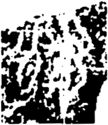

# obs-unk-004673 未释字档案

状态：未释字候选（HUST-OBC 数据集类别，未经交叉复核） | 释读史：未收集 | 例句：0 | 更新：2026-11-02

## 1 字形与观察

- 图 1：HUST-OBC 未释字 X 组第 229 类的一张样本，217 × 253 像素〔来源 src-hust-obc `HUST-OBC/undeciphered/X/229/X_？_8398_1.png`〕。
- 来源报告本类只有这一张样本。
- 观察：图像两侧边缘和下边缘有大面积密集黑色区域。
- 观察：不规则浅色间隙把中央近似竖向区域分隔开。
- 观察：深色残片打断了可连续追踪的外部轮廓。
- 观察：右上方有一个带小浅色缺口的密集黑色笔画组。
- 观察：左下方的宽大深色区域中有分散的浅色开口。
- 观察：这张阈值化图像需要更清晰的原始扫描后再细看。

## 2 隶定与今字候选

- 数据集没有给出今字标签（来源文件名中以“？”表示）。

## 10 来源与权利

- 来源 src-hust-obc，图片资产 `asset-006266`，权利状态 `source_marked_risk_noted`。HUST-OBC 的 Figshare 与期刊页面许可表述不一致，详见来源档案 `corpus/006_research-sources-and-bibliography/001_source-objects/015_src-hust-obc_source-object/`。
- 图片 SHA-256：`7c4566ca2b875e8a199d7d8d2c5e697188dbaf0810de8bf33c7ee9eb42ebb3a8`；来源包 `large-src-000001`。

## 11 待查项

- 本类只有这一张样本，是孤例；在原拓或著录中找到它的出处后才能讨论释读。
- 在殷契文渊或小学堂字形库中检索近形字，记录比较结果与出处。
