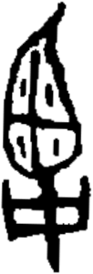

# obs-unk-004676 未释字档案

状态：未释字候选（HUST-OBC 数据集类别，未经交叉复核） | 释读史：未收集 | 例句：0 | 更新：2026-11-02

## 1 字形与观察

- 图 1：HUST-OBC 未释字 X 组第 232 类的一张样本，102 × 301 像素〔来源 src-hust-obc `HUST-OBC/undeciphered/X/232/X_？_8401_1.png`〕。
- 来源报告本类只有这一张样本。
- 观察：图像中是一组高而大体竖向排列的深色笔画。
- 观察：尖状上部笔画包围着一条狭窄的内部线条。
- 观察：上部向下进入一个带两个浅色开口的圆钝围合区。
- 观察：一段狭窄笔干把该区域与下方横向笔画相连。
- 观察：下方横向笔画内有两个浅色开口，并向下伸出竖笔。
- 观察：外部边缘不规则，两侧宽度并不相同。

## 2 隶定与今字候选

- 数据集没有给出今字标签（来源文件名中以“？”表示）。

## 10 来源与权利

- 来源 src-hust-obc，图片资产 `asset-006269`，权利状态 `source_marked_risk_noted`。HUST-OBC 的 Figshare 与期刊页面许可表述不一致，详见来源档案 `corpus/006_research-sources-and-bibliography/001_source-objects/015_src-hust-obc_source-object/`。
- 图片 SHA-256：`3d6fb44b900117487a46ca57a05a597f413277795c24ade71f1b87ed202043f4`；来源包 `large-src-000001`。

## 11 待查项

- 本类只有这一张样本，是孤例；在原拓或著录中找到它的出处后才能讨论释读。
- 在殷契文渊或小学堂字形库中检索近形字，记录比较结果与出处。
