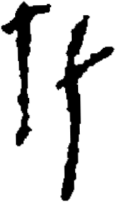

# obs-unk-004692 未释字档案

状态：未释字候选（HUST-OBC 数据集类别，未经交叉复核） | 释读史：未收集 | 例句：0 | 更新：2026-11-02

## 1 字形与观察

- 图 1：HUST-OBC 未释字 X 组第 248 类的一张样本，164 × 286 像素〔来源 src-hust-obc `HUST-OBC/undeciphered/X/248/X_？_8415_1.png`〕。
- 来源报告本类只有这一张样本。
- 观察：两组主要深色笔画分离立在浅色背景上。
- 观察：左侧组上端有一条短横向延伸笔画。
- 观察：左侧长而狭窄的笔干以尖状下端结束。
- 观察：右侧组有一条高大的中央笔干和上部斜向分支。
- 观察：另一条分支从上部中央区域向右侧伸出。
- 观察：右侧笔干继续向下，超过左侧组的下端高度。

## 2 隶定与今字候选

- 数据集没有给出今字标签（来源文件名中以“？”表示）。

## 10 来源与权利

- 来源 src-hust-obc，图片资产 `asset-006285`，权利状态 `source_marked_risk_noted`。HUST-OBC 的 Figshare 与期刊页面许可表述不一致，详见来源档案 `corpus/006_research-sources-and-bibliography/001_source-objects/015_src-hust-obc_source-object/`。
- 图片 SHA-256：`764ccfa4782800519c52dd8bb3498449aa40a1fa557de52a6d07fb3a9dc5012d`；来源包 `large-src-000001`。

## 11 待查项

- 本类只有这一张样本，是孤例；在原拓或著录中找到它的出处后才能讨论释读。
- 在殷契文渊或小学堂字形库中检索近形字，记录比较结果与出处。
