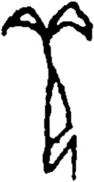

# obs-unk-004699 未释字档案

状态：未释字候选（HUST-OBC 数据集类别，未经交叉复核） | 释读史：未收集 | 例句：0 | 更新：2026-11-02

## 1 字形与观察

- 图 1：HUST-OBC 未释字 X 组第 255 类的一张样本，157 × 304 像素〔来源 src-hust-obc `HUST-OBC/undeciphered/X/255/X_？_7228_1.png`〕。
- 来源报告本类共有 2 张样本；本目录只保存其中一张。
- 观察：两条拱形上部笔画从中央连接处分别向左和向右展开。
- 观察：每条上部笔画的弯曲外缘下方都有一处浅色间隙。
- 观察：一条长中央笔干从连接处向下延伸。
- 观察：下部中央出现一个狭窄的三角形浅色开口。
- 观察：下方区域分成两条斜向深色笔画。
- 观察：来源元数据预期有两张图，但当前只有一张本地复核图。

## 2 隶定与今字候选

- 数据集没有给出今字标签（来源文件名中以“？”表示）。

## 10 来源与权利

- 来源 src-hust-obc，图片资产 `asset-006292`，权利状态 `source_marked_risk_noted`。HUST-OBC 的 Figshare 与期刊页面许可表述不一致，详见来源档案 `corpus/006_research-sources-and-bibliography/001_source-objects/015_src-hust-obc_source-object/`。
- 图片 SHA-256：`b52461d0225e5da61a2d14b3368dfe7a6069fe3befa2fb78f4372ea33dbc38cd`；来源包 `large-src-000001`。

## 11 待查项

- 查看 HUST-OBC 本类其余样本（来源报告共 2 张）的文件名，确认是否带有著录号，并检查它们是否真是同一字。
- 在殷契文渊或小学堂字形库中检索近形字，记录比较结果与出处。
