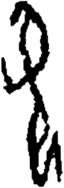

# obs-unk-004727 未释字档案

状态：未释字候选（HUST-OBC 数据集类别，未经交叉复核） | 释读史：未收集 | 例句：0 | 更新：2026-11-02

## 1 字形与观察

- 图 1：HUST-OBC 未释字 X 组第 283 类的一张样本，109 × 320 像素〔来源 src-hust-obc `HUST-OBC/undeciphered/X/283/X_？_7262_1.png`〕。
- 来源报告本类只有这一张样本。
- 观察：The upper form curves around a long pale enclosed opening.
- 观察：A short left projection extends from the upper junction.
- 观察：The central junction descends into a narrow irregular stroke.
- 观察：A second pale opening appears in the lower central area.
- 观察：The lower-right stroke ends in a short upright or pointed terminal.
- 观察：These observations describe visible marks only; no component, variant, or reading is assigned.

## 2 隶定与今字候选

- 数据集没有给出今字标签（来源文件名中以“？”表示）。

## 10 来源与权利

- 来源 src-hust-obc，图片资产 `asset-006320`，权利状态 `source_marked_risk_noted`。HUST-OBC 的 Figshare 与期刊页面许可表述不一致，详见来源档案 `corpus/006_research-sources-and-bibliography/001_source-objects/015_src-hust-obc_source-object/`。
- 图片 SHA-256：`ada8808ab2e20efa1342296bdc6551ed764befb574ed1982f3682bec9a11ebaf`；来源包 `large-src-000001`。

## 11 待查项

- 本类只有这一张样本，是孤例；在原拓或著录中找到它的出处后才能讨论释读。
- 在殷契文渊或小学堂字形库中检索近形字，记录比较结果与出处。
