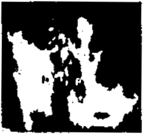

# obs-unk-004760 未释字档案

状态：未释字候选（HUST-OBC 数据集类别，未经交叉复核） | 释读史：未收集 | 例句：0 | 更新：2026-11-02

## 1 字形与观察

- 图 1：HUST-OBC 未释字 X 组第 316 类的一张样本，280 × 263 像素〔来源 src-hust-obc `HUST-OBC/undeciphered/X/316/X_？_7300_1.png`〕。
- 来源报告本类只有这一张样本。
- 观察：The image has a dark filled background with irregular pale areas.
- 观察：Contrast is high and the polarity appears reversed or thresholded.
- 观察：Stroke boundaries are not stable enough for a reliable shape record.
- 观察：Small pale gaps are visible, but their relation to strokes is uncertain.
- 观察：No component, variant, or reading is assigned from this image.

## 2 隶定与今字候选

- 数据集没有给出今字标签（来源文件名中以“？”表示）。

## 10 来源与权利

- 来源 src-hust-obc，图片资产 `asset-006353`，权利状态 `source_marked_risk_noted`。HUST-OBC 的 Figshare 与期刊页面许可表述不一致，详见来源档案 `corpus/006_research-sources-and-bibliography/001_source-objects/015_src-hust-obc_source-object/`。
- 图片 SHA-256：`cc9df6a37e14753062801df31db87ee0bf6f81bd346961a65ca6afe50bb50d42`；来源包 `large-src-000001`。

## 11 待查项

- 本类只有这一张样本，是孤例；在原拓或著录中找到它的出处后才能讨论释读。
- 在殷契文渊或小学堂字形库中检索近形字，记录比较结果与出处。
