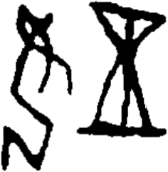

# obs-unk-004765 未释字档案

状态：未释字候选（HUST-OBC 数据集类别，未经交叉复核） | 释读史：未收集 | 例句：0 | 更新：2026-11-02

## 1 字形与观察

- 图 1：HUST-OBC 未释字 X 组第 321 类的一张样本，236 × 243 像素〔来源 src-hust-obc `HUST-OBC/undeciphered/X/321/X_？_7306_1.png`〕。
- 来源报告本类共有 2 张样本；本目录只保存其中一张。
- 观察：The left group has a small upper opening and a long curved descending stroke.
- 观察：A lower zigzag continues from the left group toward the bottom edge.
- 观察：The right group forms a broad triangular enclosure with a pale interior.
- 观察：A narrow central stroke descends inside the right enclosure.
- 观察：The two groups are separated by a clear white gap.
- 观察：These observations describe visible marks only; no component, variant, or reading is assigned.

## 2 隶定与今字候选

- 数据集没有给出今字标签（来源文件名中以“？”表示）。

## 10 来源与权利

- 来源 src-hust-obc，图片资产 `asset-006358`，权利状态 `source_marked_risk_noted`。HUST-OBC 的 Figshare 与期刊页面许可表述不一致，详见来源档案 `corpus/006_research-sources-and-bibliography/001_source-objects/015_src-hust-obc_source-object/`。
- 图片 SHA-256：`c0d6cca43dce4c02e29fa99674089f9784510ecb547626a784b74a26b662b706`；来源包 `large-src-000001`。

## 11 待查项

- 查看 HUST-OBC 本类其余样本（来源报告共 2 张）的文件名，确认是否带有著录号，并检查它们是否真是同一字。
- 在殷契文渊或小学堂字形库中检索近形字，记录比较结果与出处。
