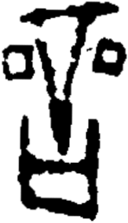

# obs-unk-004825 未释字档案

状态：未释字候选（HUST-OBC 数据集类别，未经交叉复核） | 释读史：未收集 | 例句：0 | 更新：2026-11-02

## 1 字形与观察

- 图 1：HUST-OBC 未释字 X 组第 381 类的一张样本，163 × 282 像素〔来源 src-hust-obc `HUST-OBC/undeciphered/X/381/X_？_7365_1.png`〕。
- 来源报告本类共有 2 张样本；本目录只保存其中一张。
- 观察：An irregular horizontal stroke spans the upper edge.
- 观察：Two descending strokes meet below it and narrow into a dark central tip.
- 观察：Separate rounded square-like marks with pale centers appear on both sides.
- 观察：The lower section forms a broad U-shaped outline with two upright posts.
- 观察：A pale rectangular opening remains inside the lower outline.
- 观察：The upper and lower groups are separated by white space.
- 观察：These observations describe visible marks only; no component, variant, or reading is assigned.

## 2 隶定与今字候选

- 数据集没有给出今字标签（来源文件名中以“？”表示）。

## 10 来源与权利

- 来源 src-hust-obc，图片资产 `asset-006418`，权利状态 `source_marked_risk_noted`。HUST-OBC 的 Figshare 与期刊页面许可表述不一致，详见来源档案 `corpus/006_research-sources-and-bibliography/001_source-objects/015_src-hust-obc_source-object/`。
- 图片 SHA-256：`8370e05997053b59f4cedcd552ac65f47e9eb14e7e9380405bd3fa8d9276d5d1`；来源包 `large-src-000001`。

## 11 待查项

- 查看 HUST-OBC 本类其余样本（来源报告共 2 张）的文件名，确认是否带有著录号，并检查它们是否真是同一字。
- 在殷契文渊或小学堂字形库中检索近形字，记录比较结果与出处。
