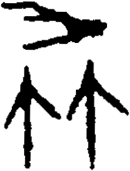

# obs-unk-004872 未释字档案

状态：未释字候选（HUST-OBC 数据集类别，未经交叉复核） | 释读史：未收集 | 例句：0 | 更新：2026-11-02

## 1 字形与观察

- 图 1：HUST-OBC 未释字 X 组第 428 类的一张样本，213 × 281 像素〔来源 src-hust-obc `HUST-OBC/undeciphered/X/428/X_？_7411_1.png`〕。
- 来源报告本类共有 3 张样本；本目录只保存其中一张。
- 观察：上部是一组不规则的粗横向深色笔画。
- 观察：上部结构下缘可见数个短突笔。
- 观察：上部下方有两个彼此分开的折角结构。
- 观察：两个下部结构都带尖顶，并有长笔画向下延伸。
- 观察：右侧下部结构另有一条斜向外伸笔画。
- 观察：上下两组之间有明显的宽空白。

## 2 隶定与今字候选

- 数据集没有给出今字标签（来源文件名中以“？”表示）。

## 10 来源与权利

- 来源 src-hust-obc，图片资产 `asset-006465`，权利状态 `source_marked_risk_noted`。HUST-OBC 的 Figshare 与期刊页面许可表述不一致，详见来源档案 `corpus/006_research-sources-and-bibliography/001_source-objects/015_src-hust-obc_source-object/`。
- 图片 SHA-256：`26cd8816550955cc39f683653e6ccf8010c0d8ce2568d70dbbd687b25512a9b8`；来源包 `large-src-000001`。

## 11 待查项

- 查看 HUST-OBC 本类其余样本（来源报告共 3 张）的文件名，确认是否带有著录号，并检查它们是否真是同一字。
- 在殷契文渊或小学堂字形库中检索近形字，记录比较结果与出处。
