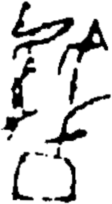

# obs-unk-004876 未释字档案

状态：未释字候选（HUST-OBC 数据集类别，未经交叉复核） | 释读史：未收集 | 例句：0 | 更新：2026-11-02

## 1 字形与观察

- 图 1：HUST-OBC 未释字 X 组第 432 类的一张样本，161 × 292 像素〔来源 src-hust-obc `HUST-OBC/undeciphered/X/432/X_？_7415_1.png`〕。
- 来源报告本类只有这一张样本。
- 观察：顶部有一条小弧形标记和一组较大的折角结构。
- 观察：较大上部结构的尖顶附近留有浅色开口。
- 观察：中部有两条彼此分开的不规则下行笔画。
- 观察：下部占据画面的是一个宽大的圆钝外框。
- 观察：下部外框内部留有浅色区域，底缘不规则。
- 观察：上、中、下各组之间保留明显空隙。

## 2 隶定与今字候选

- 数据集没有给出今字标签（来源文件名中以“？”表示）。

## 10 来源与权利

- 来源 src-hust-obc，图片资产 `asset-006469`，权利状态 `source_marked_risk_noted`。HUST-OBC 的 Figshare 与期刊页面许可表述不一致，详见来源档案 `corpus/006_research-sources-and-bibliography/001_source-objects/015_src-hust-obc_source-object/`。
- 图片 SHA-256：`dc59836bdd42457527965f6e5f801516e16708c0df6d12dd60af1d4f48343ac0`；来源包 `large-src-000001`。

## 11 待查项

- 本类只有这一张样本，是孤例；在原拓或著录中找到它的出处后才能讨论释读。
- 在殷契文渊或小学堂字形库中检索近形字，记录比较结果与出处。
