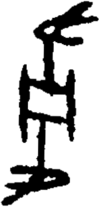

# obs-unk-004877 未释字档案

状态：未释字候选（HUST-OBC 数据集类别，未经交叉复核） | 释读史：未收集 | 例句：0 | 更新：2026-11-02

## 1 字形与观察

- 图 1：HUST-OBC 未释字 X 组第 433 类的一张样本，167 × 344 像素〔来源 src-hust-obc `HUST-OBC/undeciphered/X/433/X_？_7416_1.png`〕。
- 来源报告本类只有这一张样本。
- 观察：上部有一组粗大的分枝结构。
- 观察：上部结构内有一个小浅色开口，并向两侧伸出长笔画。
- 观察：上部结构向下连接一条深色直笔画。
- 观察：中部有一个上下边缘不规则的宽大外框。
- 观察：中部外框两侧各有短突笔。
- 观察：下部长直笔画连接到粗大的弧形底部，并带有尾状笔画。

## 2 隶定与今字候选

- 数据集没有给出今字标签（来源文件名中以“？”表示）。

## 10 来源与权利

- 来源 src-hust-obc，图片资产 `asset-006470`，权利状态 `source_marked_risk_noted`。HUST-OBC 的 Figshare 与期刊页面许可表述不一致，详见来源档案 `corpus/006_research-sources-and-bibliography/001_source-objects/015_src-hust-obc_source-object/`。
- 图片 SHA-256：`2c4bd6230c214133b4602886ad3c9d7da341185e94ca481a1794b1147add7292`；来源包 `large-src-000001`。

## 11 待查项

- 本类只有这一张样本，是孤例；在原拓或著录中找到它的出处后才能讨论释读。
- 在殷契文渊或小学堂字形库中检索近形字，记录比较结果与出处。
