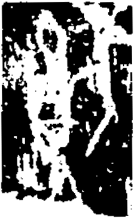

# obs-unk-004914 未释字档案

状态：未释字候选（HUST-OBC 数据集类别，未经交叉复核） | 释读史：未收集 | 例句：0 | 更新：2026-11-02

## 1 字形与观察

- 图 1：HUST-OBC 未释字 X 组第 470 类的一张样本，224 × 364 像素〔来源 src-hust-obc `HUST-OBC/undeciphered/X/470/X_？_7455_1.png`〕。
- 来源报告本类只有这一张样本。
- 观察：图像是噪声较多的高反差裁切，中央有一片浅色密集区域。
- 观察：中央密集区域被数处深色开口和不规则斑块打断。
- 观察：右侧大部分区域由深色块面占据。
- 观察：上、下边缘附近还可见较小的浅色和深色标记。
- 观察：当前裁切没有保留清晰的痕迹外轮廓。
- 观察：当前阈值化图像不足以可靠区分单独笔画。

## 2 隶定与今字候选

- 数据集没有给出今字标签（来源文件名中以“？”表示）。

## 10 来源与权利

- 来源 src-hust-obc，图片资产 `asset-006507`，权利状态 `source_marked_risk_noted`。HUST-OBC 的 Figshare 与期刊页面许可表述不一致，详见来源档案 `corpus/006_research-sources-and-bibliography/001_source-objects/015_src-hust-obc_source-object/`。
- 图片 SHA-256：`c0b073491550b44aae94a5265a3fa8856759e95053008b8ba0c105a04311c59a`；来源包 `large-src-000001`。

## 11 待查项

- 本类只有这一张样本，是孤例；在原拓或著录中找到它的出处后才能讨论释读。
- 在殷契文渊或小学堂字形库中检索近形字，记录比较结果与出处。
