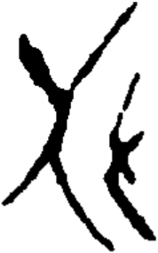

# obs-unk-004960 未释字档案

状态：未释字候选（HUST-OBC 数据集类别，未经交叉复核） | 释读史：未收集 | 例句：0 | 更新：2026-11-02

## 1 字形与观察

- 图 1：HUST-OBC 未释字 X 组第 516 类的一张样本，178 × 285 像素〔来源 src-hust-obc `HUST-OBC/undeciphered/X/516/X_？_7497_1.png`〕。
- 来源报告本类只有这一张样本。
- 观察：左侧较大结构从中央交叉处向上、向下分出笔画。
- 观察：上部分枝较长，向右上方逐渐变细。
- 观察：左下笔画从交叉处向左下方斜向伸展。
- 观察：右侧另有一组较窄直立笔画和下部弧形分枝。
- 观察：右侧结构下部中央附近有一处向内的小钩状转折。

## 2 隶定与今字候选

- 数据集没有给出今字标签（来源文件名中以“？”表示）。

## 10 来源与权利

- 来源 src-hust-obc，图片资产 `asset-006553`，权利状态 `source_marked_risk_noted`。HUST-OBC 的 Figshare 与期刊页面许可表述不一致，详见来源档案 `corpus/006_research-sources-and-bibliography/001_source-objects/015_src-hust-obc_source-object/`。
- 图片 SHA-256：`1b5b33825338ee694555ab47cd70a93977347a4f8af2926ae019109f02aa6f44`；来源包 `large-src-000001`。

## 11 待查项

- 本类只有这一张样本，是孤例；在原拓或著录中找到它的出处后才能讨论释读。
- 在殷契文渊或小学堂字形库中检索近形字，记录比较结果与出处。
