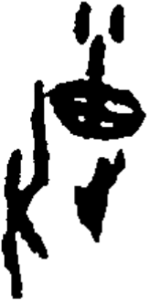

# obs-unk-004966 未释字档案

状态：未释字候选（HUST-OBC 数据集类别，未经交叉复核） | 释读史：未收集 | 例句：0 | 更新：2026-11-02

## 1 字形与观察

- 图 1：HUST-OBC 未释字 X 组第 522 类的一张样本，162 × 330 像素〔来源 src-hust-obc `HUST-OBC/undeciphered/X/522/X_？_7503_1.png`〕。
- 来源报告本类只有这一张样本。
- 观察：一处较宽的中央圆钝结构上方有两枚分离短痕。
- 观察：中央结构内部可见数个较小的浅色开口。
- 观察：左侧一条窄长主干向下延伸，并在下半部出现分枝。
- 观察：下方另有一组上部较宽、末端尖收的深色痕迹。
- 观察：当前图像显示多组分离痕迹，未见一条确定的共同轮廓。

## 2 隶定与今字候选

- 数据集没有给出今字标签（来源文件名中以“？”表示）。

## 10 来源与权利

- 来源 src-hust-obc，图片资产 `asset-006559`，权利状态 `source_marked_risk_noted`。HUST-OBC 的 Figshare 与期刊页面许可表述不一致，详见来源档案 `corpus/006_research-sources-and-bibliography/001_source-objects/015_src-hust-obc_source-object/`。
- 图片 SHA-256：`f07dfdef874386a9e3df2e9cb3d3d975d40c38c4eaa925864b87fbbc5d9083ec`；来源包 `large-src-000001`。

## 11 待查项

- 本类只有这一张样本，是孤例；在原拓或著录中找到它的出处后才能讨论释读。
- 在殷契文渊或小学堂字形库中检索近形字，记录比较结果与出处。
