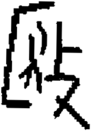

# obs-unk-004972 未释字档案

状态：未释字候选（HUST-OBC 数据集类别，未经交叉复核） | 释读史：未收集 | 例句：0 | 更新：2026-11-02

## 1 字形与观察

- 图 1：HUST-OBC 未释字 X 组第 528 类的一张样本，185 × 266 像素〔来源 src-hust-obc `HUST-OBC/undeciphered/X/528/X_？_7508_1.png`〕。
- 来源报告本类只有这一张样本。
- 观察：左侧较大轮廓在上、下部各有横向转折。
- 观察：左侧轮廓内部有一条较短的弧形笔画。
- 观察：右侧中央另有一条直立主干，并伸出数条横向笔画。
- 观察：右下区域出现一条交叉的斜向分枝。
- 观察：当前图像显示多组相邻结构，未确认整体存在共同封闭边界。

## 2 隶定与今字候选

- 数据集没有给出今字标签（来源文件名中以“？”表示）。

## 10 来源与权利

- 来源 src-hust-obc，图片资产 `asset-006565`，权利状态 `source_marked_risk_noted`。HUST-OBC 的 Figshare 与期刊页面许可表述不一致，详见来源档案 `corpus/006_research-sources-and-bibliography/001_source-objects/015_src-hust-obc_source-object/`。
- 图片 SHA-256：`79f9256bf3a3e15da189bf172c7ded6f7cf30e2aeb435561778cd03cca0403dc`；来源包 `large-src-000001`。

## 11 待查项

- 本类只有这一张样本，是孤例；在原拓或著录中找到它的出处后才能讨论释读。
- 在殷契文渊或小学堂字形库中检索近形字，记录比较结果与出处。
