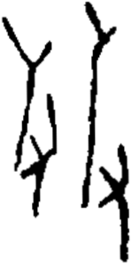

# obs-unk-004977 未释字档案

状态：未释字候选（HUST-OBC 数据集类别，未经交叉复核） | 释读史：未收集 | 例句：0 | 更新：2026-11-02

## 1 字形与观察

- 图 1：HUST-OBC 未释字 X 组第 533 类的一张样本，148 × 298 像素〔来源 src-hust-obc `HUST-OBC/undeciphered/X/533/X_？_7513_1.png`〕。
- 来源报告本类只有这一张样本。
- 观察：当前图像中有两组彼此分离的高位深色结构。
- 观察：左侧结构上部分叉，下部有一处侧面开口。
- 观察：左侧开口下方的笔画逐渐收窄并向下结束。
- 观察：右侧结构有一条近竖直长主干和一条顶部短分枝。
- 观察：右侧主干下部向外伸出一条分枝。

## 2 隶定与今字候选

- 数据集没有给出今字标签（来源文件名中以“？”表示）。

## 10 来源与权利

- 来源 src-hust-obc，图片资产 `asset-006570`，权利状态 `source_marked_risk_noted`。HUST-OBC 的 Figshare 与期刊页面许可表述不一致，详见来源档案 `corpus/006_research-sources-and-bibliography/001_source-objects/015_src-hust-obc_source-object/`。
- 图片 SHA-256：`a7d4f6268fb0bb04cea7a54a00421c617152078da1d53a56e6aed33bd3008ba7`；来源包 `large-src-000001`。

## 11 待查项

- 本类只有这一张样本，是孤例；在原拓或著录中找到它的出处后才能讨论释读。
- 在殷契文渊或小学堂字形库中检索近形字，记录比较结果与出处。
