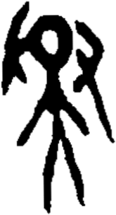

# obs-unk-004980 未释字档案

状态：未释字候选（HUST-OBC 数据集类别，未经交叉复核） | 释读史：未收集 | 例句：0 | 更新：2026-11-02

## 1 字形与观察

- 图 1：HUST-OBC 未释字 X 组第 536 类的一张样本，165 × 304 像素〔来源 src-hust-obc `HUST-OBC/undeciphered/X/536/X_？_7516_1.png`〕。
- 来源报告本类共有 5 张样本；本目录只保存其中一张。
- 观察：中央有一组密集结构，左上内部留有圆形浅色开口。
- 观察：左侧外轮廓沿中央结构旁向下钩曲。
- 观察：右侧有一组较窄结构，从中上部向下弯曲延伸。
- 观察：多条长笔画从中央下部连接处向下延伸。
- 观察：下部笔画分散为多条逐渐收窄的分枝。

## 2 隶定与今字候选

- 数据集没有给出今字标签（来源文件名中以“？”表示）。

## 10 来源与权利

- 来源 src-hust-obc，图片资产 `asset-006573`，权利状态 `source_marked_risk_noted`。HUST-OBC 的 Figshare 与期刊页面许可表述不一致，详见来源档案 `corpus/006_research-sources-and-bibliography/001_source-objects/015_src-hust-obc_source-object/`。
- 图片 SHA-256：`04bf9025686ab490c352345fba0943e260e205f8219cfebec21874707d2b7b49`；来源包 `large-src-000001`。

## 11 待查项

- 查看 HUST-OBC 本类其余样本（来源报告共 5 张）的文件名，确认是否带有著录号，并检查它们是否真是同一字。
- 在殷契文渊或小学堂字形库中检索近形字，记录比较结果与出处。
