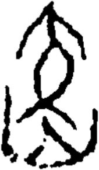

# obs-unk-006258 未释字档案

状态：未释字候选（HUST-OBC 数据集类别，未经交叉复核） | 释读史：未收集 | 例句：0 | 更新：2026-11-02

## 1 字形与观察

- 图 1：HUST-OBC 未释字 X 组第 1814 类的一张样本，170 × 291 像素〔来源 src-hust-obc `HUST-OBC/undeciphered/X/1814/X_？_4735_1.png`〕。
- 来源报告本类共有 46 张样本；本目录只保存其中一张。
- 观察：图像上方有弧拱环状形，中部有分离的弯曲闭合形，下方是不规则组合，两侧可见分离笔画。本记录不确认字形身份。

## 2 隶定与今字候选

- 数据集没有给出今字标签（来源文件名中以“？”表示）。

## 10 来源与权利

- 来源 src-hust-obc，图片资产 `asset-007850`，权利状态 `source_marked_risk_noted`。HUST-OBC 的 Figshare 与期刊页面许可表述不一致，详见来源档案 `corpus/006_research-sources-and-bibliography/001_source-objects/015_src-hust-obc_source-object/`。
- 图片 SHA-256：`7a834e613cfac08f269fb2bbe46c09c30463c69793bfd24eae22aa97e1478185`；来源包 `large-src-000001`。

## 11 待查项

- 查看 HUST-OBC 本类其余样本（来源报告共 46 张）的文件名，确认是否带有著录号，并检查它们是否真是同一字。
- 在殷契文渊或小学堂字形库中检索近形字，记录比较结果与出处。
