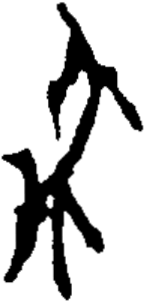

# obs-unk-006553 未释字档案

状态：未释字候选（HUST-OBC 数据集类别，未经交叉复核） | 释读史：未收集 | 例句：0 | 更新：2026-11-02

## 1 字形与观察

- 图 1：HUST-OBC 未释字 X 组第 2109 类的一张样本，145 × 302 像素〔来源 src-hust-obc `HUST-OBC/undeciphered/X/2109/X_？_5999_1.png`〕。
- 来源报告本类共有 39 张样本；本目录只保存其中一张。
- 观察：图像呈高而尖顶的外轮廓，中部有笔画交叉，下方和两侧都有多条较长的分叉笔画。本记录不确认字形身份。

## 2 隶定与今字候选

- 数据集没有给出今字标签（来源文件名中以“？”表示）。

## 10 来源与权利

- 来源 src-hust-obc，图片资产 `asset-008144`，权利状态 `source_marked_risk_noted`。HUST-OBC 的 Figshare 与期刊页面许可表述不一致，详见来源档案 `corpus/006_research-sources-and-bibliography/001_source-objects/015_src-hust-obc_source-object/`。
- 图片 SHA-256：`2eec9fb7bbe9a30a0e5ce80519b2a396acad751b6478f3e7da8cceb2e204b310`；来源包 `large-src-000001`。

## 11 待查项

- 查看 HUST-OBC 本类其余样本（来源报告共 39 张）的文件名，确认是否带有著录号，并检查它们是否真是同一字。
- 在殷契文渊或小学堂字形库中检索近形字，记录比较结果与出处。
